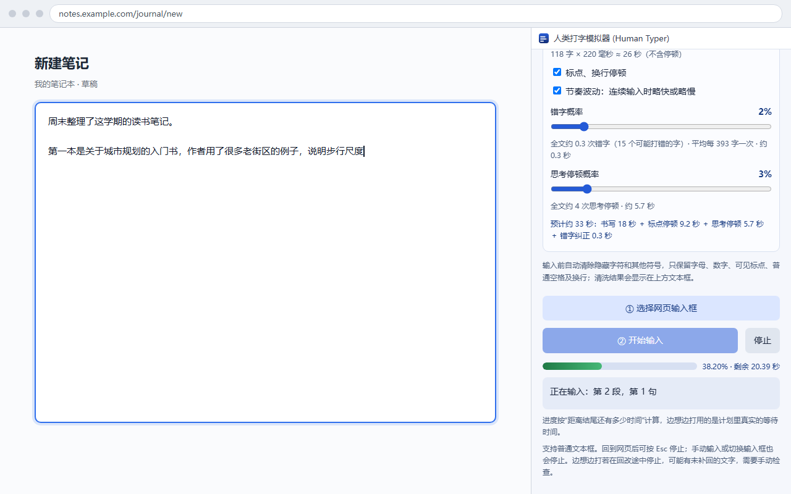
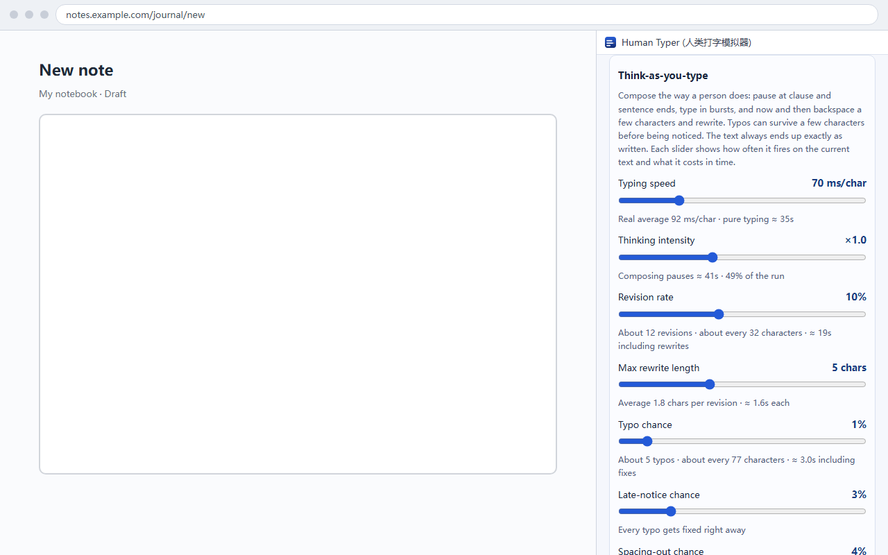

# 人类打字模拟器 · Human Typer

[中文](#中文) · [English](#english)

**人类打字模拟器（Human Typer）** 是一个免费、开源的浏览器扩展，模拟人类打字节奏，把你的文字逐字输入到网页输入框里。支持 Microsoft Edge 与 Google Chrome（Manifest V3）。

**Human Typer (人类打字模拟器)** is a free, open-source browser extension that simulates human typing: it types your text into any web field character by character, at a rhythm you set. Works in Microsoft Edge and Google Chrome (Manifest V3).

| 获取 / Get it | |
| --- | --- |
| Microsoft Edge Add-ons | [Human Typer (人类打字模拟器)](https://microsoftedge.microsoft.com/addons/detail/deaniocgmmpfklbgelnfmoeibmmfoegd) |
| Chrome Web Store | 审核中 / In review |
| 源码安装 / From source | [Releases](https://github.com/xxx12e/human-typer/releases) |

关键词 / Keywords：人类打字模拟器、模拟人类打字、自动打字、逐字输入、打字节奏、浏览器打字扩展、human typing simulator, human typer, auto typer, typing simulator, type text letter by letter, Edge extension, Chrome extension

<p>
  
  
</p>

---

## 中文

在网页输入框里按设定节奏逐字输入文字的浏览器扩展。侧边栏控制面板，两种节奏可选：固定间隔逐字输入，或按句子构思、成段输出、随手回改的「边想边打」。支持普通输入框、iframe 富文本编辑器和 Google 文档。完全免费：没有付费版、没有内购、没有广告，也不需要注册账号。

### 功能

**两种节奏**

| 模式 | 说明 |
| --- | --- |
| 常规节奏 | 在设定的最短～最长间隔内逐字随机输入，可叠加标点停顿、节奏波动、单字错字纠正和随机思考停顿。内置慢速仔细、日常输入、熟练快打三组参数。 |
| 边想边打 | 先把文字按段落、句子、分句、词语切成结构，再规划成一串步骤：在分句和句末停下构思，成段快速输出，走到词或分句边界时回删几个字重写，打错了也可能过几个字才发现。 |

**时长和参数自己定**

边想边打的参数全部是滑动条，拖动时每条下方实时显示该参数在当前文字上产生的次数与耗时：

| 参数 | 范围 | 作用 |
| --- | --- | --- |
| 书写速度 | 30～200 毫秒/字 | 成句书写时字与字的基准间隔 |
| 构思强度 | 0.4～2 倍 | 缩放所有构思停顿 |
| 回改频率 | 0～25% | 走到词或分句边界时回删重写的概率 |
| 单次回改上限 | 1～12 字 | 一次最多回删几个字 |
| 错字概率 | 0～10% | 打出邻近键位或混淆字的概率 |
| 延迟发现概率 | 0～15% | 打错后继续打几个字才一次退格重打的概率 |
| 走神长停顿概率 | 0～15% | 句末或段落后额外停 6～15 秒的概率 |
| 总时长预算 | 10 秒～120 分钟 | 让整段文字大致按指定时长打完 |

开启预算后只缩放构思类停顿，书写速度、回改次数和错字序列都不变。缩放范围限制在 0.15～8 倍，达不到目标时面板会说明是文字太短还是书写本身超时。

**进度按时间显示**

按钮正下方的进度条读数是 `38.20% · 剩余 2 分 13.45 秒`，百分比保留两位小数，按距离结尾的时间推进。边想边打用的是计划里真实的等待时间，构思停顿期间也会持续减少；常规模式按剩余字数估算。

**断点续打**

点击开始前会检查目标里已有的内容。如果光标前的内容正好是待输入文字的开头，面板会弹出提示，可以「从检测到的位置继续」或「从头输入」。要输入的文字如果已经整段存在于目标中，会提示不必重复。Google 文档正文不可读取，这里改用扩展自己记录的发送进度。

**Google 文档**

文档模式通过浏览器调试接口逐字发送真实按键事件：英文字母、数字、标点走 `keydown`/`keyup`（含 Shift 组合），中文等需要输入法提交的字符走输入法提交通道。每个按键之间按计划等待，文档收到的是一个一个键，不是整段插入。调试器权限是可选权限，只有在你主动为文档模式点击启用时才会申请；普通网页输入不需要它。

**自动清理隐藏字符**

输入前统一 NFC，制表符与 Unicode 空格转成普通空格，零宽字符、BOM、方向控制符、控制字符、私用字符、未配对代理项、表情和符号类字符会被删除，只保留字母、数字、可见标点、ASCII 空格和换行。清洗结果会回写到侧边栏文本框，方便开始前检查。

### 界面语言

侧边栏右上角有高亮的「中文 | EN」切换按钮，当前语言实心显示，点一下就切换，不用重启浏览器；选择保存在本地，下次打开保持不变。首次打开时跟随浏览器语言：中文浏览器显示中文，其他语言一律显示英文。面板文案、滑动条读数、进度、状态消息和 Google 文档模式的状态会一起切换。扩展名称与简介通过 `_locales` 本地化，默认语种为英文。

### 安装

- **商店安装**：Edge 用户直接在 [Edge 加载项商店](https://microsoftedge.microsoft.com/addons/detail/deaniocgmmpfklbgelnfmoeibmmfoegd) 安装；Chrome 版本正在审核。
- **从源码加载**：
  1. 下载本仓库，或下载 [Release](https://github.com/xxx12e/human-typer/releases) 中的 zip 并解压。
  2. Edge 打开 `edge://extensions`（Chrome 为 `chrome://extensions`），开启「开发人员模式」。
  3. 点击「加载解压缩的扩展」，选择包含 `manifest.json` 的目录。
  4. 点击浏览器工具栏的扩展图标，侧边栏打开即用。

### 使用

1. 在侧边栏填写要输入的文字，选择模式和参数。
2. 点击「① 选择网页输入框」，再点击网页上要输入的位置。需要 30 秒内完成，按 Esc 取消。
3. 点击「② 开始输入」。进度条和状态文字会显示当前阶段。
4. 过程中按 Esc、手动按键、点击其他位置或切换输入框都会停止。

### 权限说明

| 权限 | 用途 |
| --- | --- |
| `activeTab` | 取得当前标签页上下文 |
| `scripting` | 向用户选择的标签页和 iframe 注入输入引擎 |
| `sidePanel` | 使用浏览器原生侧边栏作为控制面板 |
| `host_permissions: <all_urls>` | 允许在任意网站及跨域 iframe 中寻找用户点击的输入框 |
| `optional_permissions: debugger` | 仅 Google 文档模式使用，启用时单独申请 |

### 隐私

所有代码在本地运行，没有服务器、没有第三方依赖、没有遥测，也不会把输入的文字上传到任何地方。扩展不读取整页内容：普通输入框只在点击「选择网页输入框」后接触用户选中的元素；续打检测只比较光标前后的文本；Google 文档模式不读取文档正文。文字草稿和节奏设置保存在侧边栏自己的本地存储里，清空文本框或删除扩展即可清除。完整说明见[隐私政策](https://xxx12e.github.io/human-typer/privacy.html)。

### 兼容与限制

- 支持 `textarea`、`text/search/url/tel` 类型的 `input`、`contenteditable` 富文本正文，以及主页面与跨域 iframe 中的同类元素。
- 不支持 HTML `<canvas>` 绘图表面、PDF 只读页、密码框和非文本输入类型；Word 网页版等自绘图层编辑器可能需要单独适配。
- 中文字符不模拟拼音串与候选词窗口，扩展也不模拟鼠标移动和光标移动键。
- 网页可以修改写入的内容或拒绝输入事件；检测到网页改变了文字、光标或目标被移除时会立即停止。
- 浏览器设置页、扩展商店等受保护页面无法注入脚本；`file://` 页面需要在扩展详情中开启「允许访问文件 URL」。
- 扩展通过浏览器事件输入，不是物理键盘硬件信号。

---

## English

A browser extension that types your text into a web field character by character, at a rhythm you set. The control panel lives in the browser side panel and offers two rhythms: a steady per-character interval, or "think-as-you-type", which composes sentence by sentence, types in bursts and now and then goes back to rewrite. Works with plain inputs, rich-text editors inside iframes, and Google Docs. Completely free: no paid tier, no in-app purchases, no ads, no account needed.

### Features

**Two rhythms**

| Mode | What it does |
| --- | --- |
| Fixed rhythm | Types each character at a random interval between a minimum and maximum, with optional pauses on punctuation, rhythm drift, single-character typo fixes and random thinking pauses. Three presets: careful, everyday and fast. |
| Think-as-you-type | Splits the text into paragraphs, sentences, clauses and words, then plans a sequence of steps: pauses to compose at clause and sentence ends, types in bursts, backspaces a few characters at word or clause boundaries to rewrite, and sometimes notices a typo only a few characters later. |

**Your duration, your settings**

Every think-as-you-type setting is a slider, and each one shows how often it fires on the current text and how much time it adds:

| Setting | Range | Effect |
| --- | --- | --- |
| Typing speed | 30–200 ms/char | Base interval between characters while writing |
| Thinking intensity | 0.4–2× | Scales all composing pauses |
| Revision rate | 0–25% | Chance to backspace and rewrite at a word or clause boundary |
| Max rewrite length | 1–12 chars | Most characters removed in one revision |
| Typo chance | 0–10% | Chance of hitting a neighbouring key or a look-alike character |
| Late-notice chance | 0–15% | Chance a typo is noticed only a few characters later |
| Spacing-out chance | 0–15% | Chance of an extra 6–15 s pause after a sentence or paragraph |
| Duration budget | 10 s – 120 min | Lands the whole text near a target time |

The duration budget only scales composing pauses; typing speed, revisions and typos stay the same. The scale is clamped to 0.15–8×, and the panel tells you when the text is too short or the typing itself already takes longer than the target.

**Time-based progress**

The bar under the buttons reads like `38.20% · 2m 13.45s left`, to two decimals, and advances by time remaining. Think-as-you-type uses the real waits from its plan, so the reading keeps moving during a composing pause; fixed rhythm estimates from the characters left.

**Resume**

Before starting, the target is checked for text that is already there. If the text before the caret matches the opening of what you are about to type, the panel offers to continue from that point or start over. If the whole text is already present, it says so. Google Docs content cannot be read, so the extension uses its own record of what it sent.

**Google Docs**

Docs mode sends real key events through the browser debugging protocol: letters, digits and punctuation as `keydown`/`keyup` (including Shift), and characters that need an input method (such as Chinese) through the IME commit path. Each key waits as planned, so the document receives one key at a time rather than a pasted block. The debugger permission is optional and is requested only when you turn on Docs mode; plain fields never need it.

**Hidden characters cleaned automatically**

Before typing, text is normalised to NFC; tabs and Unicode spaces become plain spaces; zero-width characters, BOMs, direction marks, control and private-use characters, unpaired surrogates, emoji and symbol characters are removed. Only letters, digits, visible punctuation, ASCII spaces and line breaks remain. The cleaned text is written back to the panel so you can check it first.

### Interface language

A highlighted **中文 | EN** switch sits in the top-right corner of the panel; the active language is filled. One click switches without a restart, and the choice is remembered. On first launch the panel follows the browser: Chinese browsers get Chinese, every other language gets English. Panel text, slider readouts, progress, status messages and Google Docs mode all switch together. The extension name and summary are localised through `_locales`, with English as the default locale.

### Install

- **From the store**: Edge users can install from [Edge Add-ons](https://microsoftedge.microsoft.com/addons/detail/deaniocgmmpfklbgelnfmoeibmmfoegd). The Chrome Web Store version is in review.
- **From source**:
  1. Download this repository, or download and unzip the zip from [Releases](https://github.com/xxx12e/human-typer/releases).
  2. Open `edge://extensions` (or `chrome://extensions`) and turn on Developer mode.
  3. Click "Load unpacked" and choose the folder that contains `manifest.json`.
  4. Click the extension icon in the toolbar to open the side panel.

### Usage

1. Enter the text in the side panel and choose a mode and settings.
2. Click "① Pick a field", then click where you want to type on the page. You have 30 seconds; Esc cancels.
3. Click "② Start typing". The progress bar and status show the current stage.
4. Esc, typing by hand, clicking elsewhere or switching fields stops the run.

### Permissions

| Permission | Why |
| --- | --- |
| `activeTab` | Context of the current tab |
| `scripting` | Inject the typing engine into the tab and iframes the user picked |
| `sidePanel` | Use the native side panel as the control panel |
| `host_permissions: <all_urls>` | Find the field the user clicks on any site, including cross-origin iframes |
| `optional_permissions: debugger` | Google Docs mode only; requested when the user enables it |

### Privacy

Everything runs locally: no server, no third-party dependencies, no telemetry, and your text is never uploaded. The extension does not read whole pages: it touches only the element you pick, resume detection compares only the text around the caret, and Docs mode does not read the document. Drafts and settings live in the side panel's own local storage; clear the text box or remove the extension to delete them. See the [privacy policy](https://xxx12e.github.io/human-typer/privacy.html).

### Compatibility and limits

- Supports `textarea`, `input` of type `text/search/url/tel`, `contenteditable` rich-text bodies, and the same elements inside cross-origin iframes.
- Does not support HTML `<canvas>` drawing surfaces, read-only PDF pages, password fields or non-text inputs; editors that draw their own layers (such as Word for the web) may need separate support.
- Chinese input does not simulate pinyin strings or the candidate window, and the extension does not simulate mouse movement or caret keys.
- A page can alter what it receives or reject input events; the run stops as soon as the page changes the text, the caret, or removes the target.
- Protected pages such as browser settings and extension stores cannot be scripted; `file://` pages need "Allow access to file URLs" in the extension details.
- Input arrives as browser events, not hardware keyboard signals.

---

## 开发 / Development

```bash
npm test          # 5 个测试套件 / 5 test suites
npm run check     # 版本、文件、本地化、无远程代码 / versions, files, locales, no remote code
npm run pack      # 生成 dist/human-typer-<version>.zip / build the store zip
```

| 文件 / File | 作用 / Role |
| --- | --- |
| `manifest.json` | 清单、权限、侧边栏入口与图标 / Manifest, permissions, side panel entry, icons |
| `_locales/` | 扩展名称与简介 / Extension name and summary (en, zh_CN) |
| `background.js` | 打开侧边栏，加载文档输入器 / Opens the side panel, loads the Docs runner |
| `popup.html` / `popup.js` | 侧边栏界面、参数、预览、进度与语言切换 / Panel UI, settings, preview, progress, language switch |
| `i18n.js` | 中英文文案表 / Chinese and English strings |
| `sanitize.js` | 字符清洗 / Character cleaning |
| `thinking.js` | 边想边打节奏规划器 / Think-as-you-type planner (pure functions) |
| `typist.js` | 普通输入框与富文本输入引擎 / Typing engine for inputs and rich text |
| `docs-target.js` / `docs-runner.js` | Google 文档选择与逐字按键 / Google Docs target and key sender |

发布流程见 [PUBLISHING.md](PUBLISHING.md)，商店文案在 [store/listing.md](store/listing.md)，技术细节见 [docs/TECHNICAL.md](docs/TECHNICAL.md)。
Release steps: [PUBLISHING.md](PUBLISHING.md). Store copy: [store/listing.md](store/listing.md). Technical notes: [docs/TECHNICAL.md](docs/TECHNICAL.md).

## 许可 / License

MIT，见 / see [LICENSE](LICENSE)。
