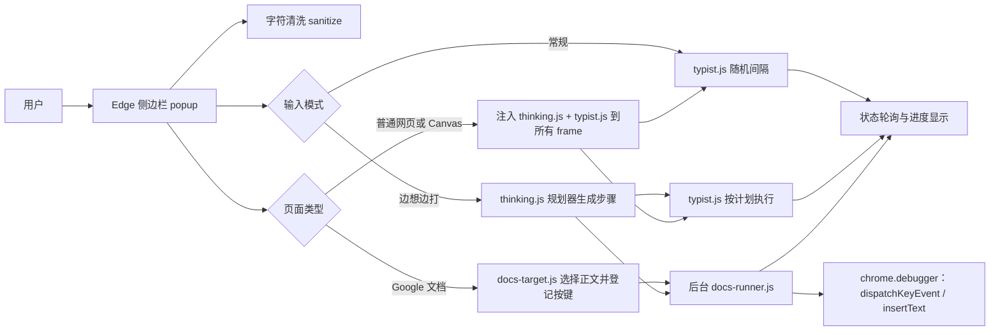

# 人类打字模拟器技术文档

版本：1.1.0  

目标浏览器：Microsoft Edge（Chromium，Manifest V3）

## 1. 项目概述

本扩展在用户明确选择的网页编辑位置中逐字输入文本。控制界面使用 Edge 原生侧边栏，因此用户点击网页时侧边栏不会像普通扩展弹窗一样关闭。

输入节奏分两套。常规模式按最短～最长间隔逐字随机输入。**边想边打**由 `thinking.js` 规划器按段落／句子／分句／词语结构生成"构思—成句—回改"的逐步计划，再由 `typist.js`（网页）或 `docs-runner.js`（Google 文档）执行。两套参数都以滑动条呈现，滑动条下方显示该参数实际产生的次数与耗时；边想边打支持总时长预算，开始前会检测目标里已写好的开头以支持续打。

当前支持：

- `textarea`；
- `text`、`search`、`url`、`tel` 类型的 `input`；
- 主页面或 iframe 中的 `contenteditable` 富文本正文，包括 Canvas LMS 讨论回复框；
- Google 文档正文，使用独立的浏览器输入适配器（目前仅支持常规模式）。


扩展不会点击提交、回复、分享或保存按钮。输入结果是否最终保存或提交由目标网站控制。

## 2. 总体结构



侧边栏负责保存配置、选择活动标签页、注入脚本、发出开始或停止命令并显示进度。网页输入引擎保存在页面的扩展隔离世界中；关闭侧边栏不会自动终止已经开始的普通网页输入任务。

`thinking.js` 是纯函数模块：不访问 DOM、不调用扩展 API、不自行取随机数（随机由注入的种子生成器产生），因此同一个文件既能注入页面世界，也能被侧边栏 `<script>` 加载用于节奏预览，还能由 `background.js` 用 `importScripts` 加载，让 Google 文档模式在后台执行同一份计划。

## 3. 文件说明

| 文件 | 作用 |
| --- | --- |
| `manifest.json` | Manifest V3 清单、权限、侧边栏入口和后台服务声明。 |
| `background.js` | 配置工具栏图标点击后打开原生侧边栏，并加载清洗器、节奏规划器与 Google 文档输入器。 |
| `popup.html` | 侧边栏界面、模式选择、两套节奏参数的滑动条、节奏预览、进度条和状态控件。 |
| `popup.js` | 保存设置、发现目标 frame、启动和停止任务、轮询进度、渲染滑动条读数、进度条与节奏预览。 |
| `sanitize.js` | 侧边栏、Google 文档后台共用的严格字符清洗器。 |
| `thinking.js` | 边想边打节奏规划器：文本结构解析、步骤计划、时长估算、总时长预算拟合。 |
| `typist.js` | 普通输入框与 `contenteditable` 富文本输入执行器：常规模式自带随机间隔，边想边打模式逐步执行规划器的计划；可选跳过目标里已经写好的开头。 |
| `docs-target.js` | Google 文档正文选择、焦点验证、状态维护，以及登记扩展自己发出的按键。 |
| `docs-runner.js` | Google 文档调试连接、逐字真实按键与输入法提交、边想边打计划执行及断开处理。 |
| `popup.js` 中的续打记录 | 文档模式每次发送后把"哪篇文档、哪段文字、发到第几个字"写入侧边栏 localStorage，供下次续打判断。 |
| `README.md` | 安装、使用、限制和自检说明。 |

## 4. Manifest 与权限

扩展使用以下权限：

- `sidePanel`：在浏览器右侧显示持久控制面板；
- `scripting`：将输入引擎注入用户当前选择的标签页及其 iframe；
- `activeTab`：取得当前活动标签页上下文；
- `debugger`：只在 Google 文档模式中调用 Chromium 输入接口；
- `<all_urls>`：允许在不同网站及跨域 iframe 中发现用户点击的输入框。

`<all_urls>` 只提供技术上的页面访问能力。当前实现仅在用户点击“选择网页输入框”后向活动标签页注入脚本，不包含网络上传代码，也不读取整页内容。

Edge 设置页、扩展商店及其他浏览器保护页面禁止扩展注入。`file://` 页面需要用户在扩展详情中另行启用“允许访问文件 URL”。

## 5. 普通网页与 Canvas 输入流程

1. `popup.js` 将 `thinking.js` 与 `typist.js` 按顺序注入活动标签页的全部 frame（规划器必须先于引擎，引擎在启动时才读取它）。
2. 每个 frame 进入 30 秒选择状态，并监听可信的点击事件。
3. `event.composedPath()` 用于找到点击路径中的可编辑元素，因此可以识别富文本正文内部的子元素。
4. 命中目标的 frame 保存元素、现有内容及光标或选区；其他 frame 保持等待或随后被停止。
5. 用户点击“开始”后，面板只向保存目标的 frame 启动任务。
6. 输入引擎逐个字素写入并更新 `completed`、`total`、`phase` 和提示文本。

普通 `input`/`textarea` 使用浏览器原生 `value` setter，先派发可取消的 `beforeinput`，写入后再派发 `input`。这样常见前端框架可以收到内容变化，同时网页仍可拒绝 `beforeinput`。

富文本正文使用当前 DOM `Range` 保存和恢复光标，通过浏览器编辑命令插入文本、段落和删除错字。每次写入后记录新的 `innerHTML` 与选区；如果网页重写正文、移动光标或移除目标，任务立即停止，防止继续写到错误位置。

富文本编辑命令本身会产生可信的 `input` 事件。引擎用 `session.writing` 标记内部写入，只把标记之外的可信输入视为用户手动编辑，避免内部事件误停任务。

### 5.1 续打检测

点击“开始”时，面板先调用执行器的 `inspect(options)`，再决定是直接开始还是先询问用户：

1. 取光标之前的文本：普通输入框用 `value.slice(0, selectionStart)`，富文本用 `Range` 从元素开头到光标，再 `toString()`；富文本比较上限 4000 字符，避免长正文过慢。
2. 把这段文本按字素切分，去掉结尾空白后，在"光标前文本的后缀"与"待输入文字的前缀"之间找最长重合（先用首字符过滤候选，再逐字比较，并有 40 万次比较的预算上限）。结尾空白如果正是待输入文字接下来的内容（例如段末换行），一并计入跳过长度。
3. 结果分四种：重合 ≥ 5 个字符且还有剩余 → 询问"继续 / 从头"；重合但已覆盖全文 → 只提供"从头"，并提示不必重复；没有重合 → 直接开始；光标之后已经存在整段相同文字 → 同样提示不必重复。
4. 用户选择后，面板把 `skipChars` 随设置一起下发。执行器把待输入文字切成 `slice(skip)`，规划器只对剩下的部分生成计划；进度按整段文字计算（`completed = skip + 已写入`），完成信息写明"已跳过开头 N 个字符"。
5. 跳过的部分不进入本次会话的写入区间：`session.anchor` 仍指向原始光标位置，因此回改永远不会删除已经写好的开头。

检测只在点击“开始”时进行，只读取光标前后的文本，不读取输入框以外的内容，也不产生任何网络请求。

### 5.2 时间进度

进度条按"距离结尾还有多少时间"推进，而不是按字数。执行器在每次状态上报时附带三个字段：

| 字段 | 含义 |
| --- | --- |
| `remainingMs` | 距离写完还剩多少毫秒 |
| `totalMs` | 本次任务的时间总量 |
| `exact` | `true` 表示来自计划（精确），`false` 表示按字估算 |

- **边想边打**：`totalMs = plan.stats.totalMs`；每执行完一步就从 `planRemaining` 里扣掉该步的等待时间，再减去当前这一步已经过去的时长（`Date.now() - stepStartedAt`），因此长时间的构思停顿期间剩余时间也在持续减少，不会卡住。停止后保留最后数值，完成时报 `remainingMs: 0`。
- **常规模式**：没有预先算好的计划，按 `剩余字数 × (平均间隔 + 思考停顿概率 × 1600 毫秒) + 标点/换行停顿` 估算；进入纠错阶段时再加约 350 毫秒。
- 面板用 `(totalMs - remainingMs) / totalMs` 得到比例，百分比用 `toFixed(2)` 显示两位小数，同时写入 `aria-valuenow`；剩余时间在 60 秒以内显示为 `12.34 秒`，超过则显示为 `2 分 13.45 秒`。
- Google 文档模式由 `docs-runner.js` 做同样的计算，通过 `docs-target.js` 的 `progress(completed, total, label, timing)` 上报。

## 6. Google 文档输入流程

Google 文档采用绘图式编辑界面，不能按普通 `textarea` 处理：

1. `docs-target.js` 确认用户点击的是文档正文输入位置，并记录焦点目标（正文 `contenteditable` 或 `docs-texteventtarget-iframe` 内的隐藏输入元素）；
2. `docs-runner.js` 验证当前地址属于 `docs.google.com/document/`；
3. 后台使用 `chrome.debugger.attach` 临时连接当前标签页；
4. 逐字发出按键或输入法提交（见 6.1），并执行节奏计划（见 6.2）；
5. 完成、停止、切换标签页、刷新、关闭页面或连接断开时自动解除调试连接。

Google 文档完成状态表示字符已经发送给编辑器，不代表服务器保存已经完成。

### 6.1 逐字真实按键

这一模式的目标是让文档收到"一个键一个键敲进去"的事件流，而不是整段插入。`docs-runner.js` 维护一张美式键盘映射表，覆盖 26 个字母（大小写）、10 个数字、空格和常见标点及其 Shift 变体：

- 能在表里查到的字符：先按需要按下 `Shift`（`keyDown`/`keyUp`，`modifiers: 8`），再发出该键的 `keyDown`（带 `text`/`unmodifiedText`）与 `keyUp`，字段包含 `key`、`code`、`windowsVirtualKeyCode`、`nativeVirtualKeyCode`、`autoRepeat: false`、`isKeypad: false`、`location: 0`；
- 换行：`Enter`，`text: '\r'`；
- 退格：`Backspace`（用于错字纠正与边想边打的回改）；
- 查不到映射的字符（中文、中文标点等）：`Input.insertText`，即 Chromium 文档中"输入法提交文本"的通道，真实拼音输入法按下候选词时文档收到的也是这一类事件。

每个字符都是一次独立的浏览器输入事件，因此文档侧的输入事件流、撤销记录粒度与打字节奏都来自逐字输入。扩展不模拟拼音串、候选词窗口、IME 组合态（`compositionstart` 仍被视为手动操作并中断任务），也不模拟鼠标与光标移动键。

`docs-target.js` 用 `expectKeys(keys)` 登记扩展即将发出的键名：`keydown` 监听器命中登记项就忽略，未登记的按键（用户真的动手）、点击、粘贴或 Esc 都会立即中断任务。登记的键名最多保留最近 8 个，避免某次按键未到达时长期吞掉用户的真实按键。

### 6.2 节奏计划执行

后台在 `background.js` 中用 `importScripts('sanitize.js', 'thinking.js', 'docs-runner.js')` 加载规划器，因此 Google 文档模式与普通网页共用同一份 `buildPlan`：

- 常规节奏：沿用原有的随机间隔、标点停顿、节奏波动、单字错字逻辑，只是把字符发送改成 6.1 的逐字按键；
- 边想边打：在后台生成计划后逐步执行，每个步骤等待 `step.wait` 再按一个键或退一格，`Input.insertText` 只用于需要输入法提交的字符；进度与阶段文案通过 `docs-target.js` 的 `progress(completed, total, label)` 上报到侧边栏；
- 等待使用可中断的 `waitDocs`，因此长达十几秒的构思停顿期间，停止、切换标签页或按 Esc 都能立即生效；
- 每个步骤前后都会调用 `check()` 验证正文焦点，同时产生一次扩展 API 调用，使 MV3 后台在长停顿中保持存活；
- 完成信息包含实际使用的停顿缩放倍率（启用总时长预算时）。

### 6.3 文档续打记录

Google 文档的正文不可读取，因此续打检测不能像普通输入框那样比对光标前的内容。改用的方案是：侧边栏在轮询到一次文档任务结束时，把 `{ url, text, sent, at }` 写入自己的 `localStorage`（与文字草稿同一处，因此不需要新增 `storage` 权限）。下次对同一篇文档点击“开始”时，如果这次要输入的文字以上次那段开头，就用上次的 `sent` 作为跳过长度，并把来源标注为“本扩展上次向这篇文档发送的记录”。记录只在面板观察到任务由 `running` 转入结束状态时写入，因此面板需要保持打开——这与文档模式本身的使用前提一致。状态里没有记录、URL 不匹配、或文字对不上时一律按正常方式从头输入。

## 7. 字符清洗
输入开始前执行 NFC Unicode 规范化，并把 Windows 换行统一为 `\n`。允许输出的字符只有：

- Unicode 字母；
- Unicode 数字；
- Unicode 标点；
- ASCII 普通空格 U+0020；
- 换行 U+000A。

制表符和其他 Unicode 空白会转换为普通空格。零宽字符、BOM、软连字符、方向控制字符、控制字符、私用字符、未配对代理项、表情、货币符号、数学符号及其他 Unicode Symbol 类字符会被删除。

清洗在侧边栏先执行一次，结果会回写到文本框供用户检查。普通网页引擎和 Google 文档后台还会各自再次清洗，避免旧页面脚本或跨上下文调用绕过规则。完成信息包含清理数量。

## 8. 节奏、停顿和错字

### 8.1 常规模式

每个字符的基础等待时间在用户设置的最短和最长间隔之间随机选择。节奏波动会让连续 4～9 个字符共享一部分速度趋势，使短段输入出现自然的快慢变化。

- 标点额外等待约 250～700 毫秒；
- 换行额外等待约 700～1500 毫秒；
- 思考停顿额外等待约 800～2400 毫秒；
- 首个字符前等待约 500～1000 毫秒。

英文错字从相邻键位中随机选择；少量常见中文字符使用预设混淆字。错字显示约 250～650 毫秒后删除，再等待约 100～260 毫秒输入正确字符。错字和思考停顿概率设为 0 时对应功能关闭。

若用户在错字显示期间主动停止，临时错字会保留，扩展不会在停止后继续修改内容。

### 8.2 边想边打模式

`thinking.js` 不按字符独立取随机数，而是先解析结构再生成完整计划：

1. `splitGraphemes` 按字素切分文本；
2. `wordFlags` 用 `Intl.Segmenter`（`granularity: 'word'`）标记词首与词尾，取不到词粒度时回退为"拉丁字母数字串成词、其他字母单字成词"；
3. 标点分为句末（`。！？!?…` 及紧跟的右引号）与分句（`，、；：,;:`），换行单独作为段落边界；
4. `buildPlan` 顺序扫描字素，为每个字素生成一条步骤，并维护 burst 计数、疲劳漂移与所在分句起点。

步骤结构：

```js
{ op: 'insert' | 'backspace', wait, char, src, pause, label, kind }
```

- `wait`：执行该步骤前等待的毫秒数；
- `src`：对应的原文字素下标，用于进度显示与回改边界；
- `pause`：`think`／`drift`／`rethink`／`word`／空，标注等待的语义；
- `kind`：`type`／`revise`／`retype`／`typo`／`fix`／`correct`，用于统计与测试；
- `label`：直接显示到侧边栏的阶段文案。

停顿按结构分档（均乘以“构思强度”）：词内为书写速度本身（每个 burst 3～14 字，首字略慢，约 4% 概率出现手指犹豫），词间额外 15～80 毫秒（约两成概率再加 80～240 毫秒），分句 250～900 毫秒，句末 1.2～4.5 秒，段落后 2.5～9 秒，首次落笔 0.6～2.5 秒。句末与段落后另有“走神长停顿概率”触发 6～15 秒的额外等待。书写速度还随进度缓慢上升最多 35%，模拟疲劳，并叠加一次幅度 ±0.25 的随机游走。

回改发生在词或分句边界：按“回改频率”触发后，回删 `1 … min(单次回改上限, 本分句已写出的字数)` 个字（分布偏向小值），停留“重想”后再原样重打。错字按“错字概率”生成，其中“延迟发现概率”决定是否先继续打 0～3 个字再一次性退格重打——延迟发现不会跨越分句、句末或换行边界。

计划由文本、参数和种子完全决定：`buildPlan({ text, params, seed, budgetMs })` 返回 `{ chars, steps, params, seed, budget, stats }`，`estimate` 统计总时长、构思停顿占比、回改次数、错字次数与最长停顿。侧边栏预览与页面执行调用同一个函数，因此预览不会与实际节奏脱节。单次计划上限 20000 个字素，超过时不生成计划并提示改用常规模式。

规划器导出 `api: 1` 作为对外接口版本，`typist.js` 只校验这个数字，因此以后调整节奏不必同步修改执行器；`version` 仍用于替换页面里残留的旧注入脚本。

### 8.3 总时长预算

`fitToBudget(steps, budgetMs)` 在步骤生成之后执行，只按同一个系数乘以“构思类”停顿（`pause` 为 `think`／`drift`／`rethink` 的步骤）：

```
书写时间 = 总时长 − 构思停顿
期望倍率 = (预算 − 书写时间) / 构思停顿
实际倍率 = clamp(期望倍率, 0.15, 8)
```

因为等待时间与倍率成线性关系，一次缩放即可精确命中预算（5% 或 400 毫秒以内视为达成）：

- **步骤结构与书写节奏完全不变**：`op`、`src`、`kind`、`label` 序列与不设预算时逐字一致，因此回改/错字序列、保真保证和删除边界保护都不受影响；
- 期望倍率超出上下限时返回 `limited: 'max' | 'min'` 与 `reached: false`，侧边栏据此用橙色文字说明是“文字太短”还是“书写时间本身超预算”，不会硬拉出不合理的结果；
- 预算只影响等待时间。浏览器对后台标签页的定时器节流会让实际耗时超出计划值，这一点在 README 中说明；
- 预算非法（非数字、≤0）时返回 `enabled: false`，按无预算处理。

### 8.4 滑动条读数

侧边栏所有节奏参数都是 `<input type="range">`，拖动时先立即刷新数值，再按 60 毫秒节流重算预览（`schedulePreview`），因此拖动过程中读数跟手，重算不会阻塞面板。每条滑动条下方的说明来自同一份统计：

| 统计字段 | 含义 | 用在哪条滑动条 |
| --- | --- | --- |
| `typeMs` | 不含任何停顿的纯书写等待时间 | 书写速度 |
| `thinkMs` / `driftMs` / `driftCount` | 构思停顿总量、走神总量与次数 | 构思强度、走神长停顿概率 |
| `reviseMs` / `reviseRuns` / `reviseChars` | 整段回改流程（含重写与重想）的时间、次数、退格字数 | 回改频率、单次回改上限 |
| `typoMs` / `typoCount` | 整段错字流程（含纠正）的时间与次数 | 错字概率 |
| `lateRuns` / `lateMs` | 一次退掉两个字以上的纠错次数与时间 | 延迟发现概率 |

`typeMs` 与 `thinkMs` 互不重叠，可直接相加；`reviseMs`、`typoMs` 覆盖整段流程，因此与 `thinkMs` 有意重叠，界面上标注为"连同重写约 X 秒"，不参与总时长的加法。概率类滑动条除了显示设置值，还显示**实际发生次数**与"平均每几字一次"的换算频率，这两个数字来自真实计划而不是理论概率。文字超过 1500 字时预览只取前 1500 字，时间按字数比例折算为全文并在文案中标注。

常规模式不生成计划，`popup.js` 用解析式估算：`字数 × (最短+最长)/2` 为书写时间，标点按 475 毫秒、换行按 1100 毫秒累加，思考停顿按概率 × 1600 毫秒，错字只统计真正可能打错的字符（ASCII 字母与 14 个混淆汉字），每次按 900 毫秒计。

## 9. 状态与停止条件

主要状态包括 `idle`、`selecting`、`ready`、`running`、`done`、`stopped` 和 `error`。侧边栏通过定时读取页面或 Google 文档后台状态显示进度。

以下情况会停止任务：

- 用户点击“停止”或在网页按 Esc；
- 用户手动按键、点击其他位置或切换输入目标；
- 网页修改了当前文字、富文本 HTML、光标或选区；
- 目标元素被删除、禁用或变成只读；
- `beforeinput` 被网页取消；
- 普通输入框达到 `maxlength`；
- Google 文档调试连接断开或标签页切换、刷新、关闭。

边想边打模式另有两条与回改相关的停止条件：

- 计划中的退格要落到本次会话写入起点之前（`session.anchor`）或已写入字数为 0 时，立即停止，避免删除用户原有文字；
- 富文本编辑器无法按 `Range` 精确删除回改文字时停止。计划模式**不允许**回退到 `execCommand('undo')`，因为那会撤销整段会话而不是计划中的几个字；`undo` 回退只保留在常规模式的单字错字纠正中。

停止策略偏向保护现有文本：检测到状态不一致后不再继续写入或删除字符。若在回改途中停止，被删掉的字不会自动补回。

## 10. 本地数据与隐私

文字草稿和节奏设置保存在侧边栏页面的扩展本地存储中。项目没有服务器端组件、第三方依赖或遥测代码，不会把输入文本上传到开发者服务器。目标网站仍可按照自身功能接收、保存和处理用户输入的内容。

清空侧边栏文字框并触发保存可以清除保存的文字草稿；删除扩展会移除扩展自身的本地数据。

## 11. 安装与更新

1. 解压发布 ZIP。
2. 在 Edge 打开 `edge://extensions`。
3. 开启“开发人员模式”。
4. 点击“加载解压缩的扩展”，选择包含 `manifest.json` 的 `edge-human-typer` 文件夹。
5. 更新文件后在扩展卡片点击“重新加载”，并刷新准备输入的网页。

扩展错误页面会保留旧版本的历史记录。更新后应先点击“全部清除”，重新加载扩展并刷新目标网页；只有再次出现的记录才代表当前版本错误。

## 12. 测试范围

当前自动测试覆盖：

- 严格字符白名单、Unicode 空白转换和 NFC 规范化；
- 普通文本框逐字输入、选区替换、换行、停止和长度限制；
- 错字生成、停留、退格纠正和停止后的行为；
- 页面修改文字或光标、取消 `beforeinput` 时的保护性停止；
- 选择超时、重复开始、Esc 取消和脚本点击拒绝；
- 边想边打计划的确定性（同种子同结果）、停顿分档、burst 聚集、单次回改上限、延迟发现多字退格、参数夹紧与估算自洽；
- 总时长预算的达成精度、上下限夹紧与原因标记、关闭或非法值不生效、预算不改变步骤结构与书写时间；
- 边想边打保真性：在 450 组文本／种子／参数／预算组合下执行完整计划，最终文字必须与原文完全一致，且任何退格都不得越过会话起点；
- 边想边打在真实扩展中的端到端流程：模式切换、规划器注入、节奏预览渲染、阶段化状态文案、完成后的文字一致，以及总时长预算的预览倍率、上限提示与按预算运行后的结果；
- 滑动条读数：每条滑动条下方必须出现对应参数的实际次数与耗时，且不得停留在占位文案；概率类参数的读数与"平均每几字一次"换算一致；
- 统计口径：`typeMs`／`thinkMs` 与步骤逐一对应且不重叠，`driftCount` 与走神步骤数一致，延迟发现只统计一次退两个字以上的纠错；
- 边想边打执行器的完成信息包含实际停顿缩放倍率；
- 实际 Edge 加载 Manifest V3 扩展和原生侧边栏配置；
- 主 frame、跨域 iframe 和 Canvas 风格 `contenteditable`；
- Google 文档模拟地址中的调试输入、中文、换行、退格、字符清洗和断开；
- Google 文档中的边想边打：逐字真实按键（每次输入都有独立的 `keydown`）、按键间隔中位数为人类尺度而非一次性粘贴、总耗时符合预算、完稿文字与输入一致、完成信息报告缩放倍率；
- 续打检测：普通输入框按光标前内容提示、选择继续后只输入剩下的部分且不触碰开头、相同内容提示不必重复、Google 文档按本地记录提示"已有开头 N / M"与"不必重复"；
- 续打检测的边界：尾随换行计入已输入、重合少于 5 个字符不触发、无关内容不触发、光标后已有整段文字时提示重复、`skipChars` 覆盖全文时拒绝开始；
- 进度条：位于开始/停止按钮正下方（与按钮的间距在 40 像素以内）、空闲时为 `0.00% · 等待开始`、按时间推进（预算运行期间两次采样的百分比必须增长）、读数形如 `38.20% · 剩余 2 分 13.45 秒`、完成后为 `100.00% · 剩余 0.00 秒` 且 `aria-valuenow` 同步；Google 文档模式同样按该格式显示；
- 旧版注入引擎残留时的版本替换。

自动测试使用本地模拟页面验证编辑器行为，没有登录或修改真实 Canvas、Google 文档账号中的内容。网站升级编辑器实现后，专用适配可能需要同步更新。

## 13. 已知限制

- HTML `<canvas>` 绘图表面、PDF 只读页面和评分量表不是文字输入控件；必须点击网站实际提供的评论或回复编辑器。
- Word 网页版等使用自定义绘图层的编辑器可能需要单独适配。
- 密码框和非文本类型 `input` 不受支持。
- 边想边打模式暂不支持改写文字：回改只会原样重打，结束时正文与输入完全一致。
- Google 文档中的中文按输入法提交通道逐字发送，不模拟拼音串、候选词窗口与 IME 组合态；扩展也不模拟鼠标移动和光标移动键。
- 总时长预算只能调整停顿：书写速度决定的下限无法突破，短文本最多把停顿放大 8 倍，因此过大的预算无法达成，面板会明确说明。
- 预算基于计划的等待时间；后台标签页被浏览器节流时实际耗时会更长。
- 边想边打的回改依赖精确删除；部分富文本编辑器只提供粗粒度的撤销能力，此时会停止并提示，而不是退回整段撤销。
- 网页可以修改扩展写入的格式或拒绝输入事件。
- 续打检测只管"开头是否已经写好"：如果目标里已经写好的部分与要输入的文字中间有差异（例如手动改写过一个词），检测不会命中，此时需要"从头输入"或手动对齐文字。
- Google 文档的续打依据扩展自己的发送记录，不是文档真实内容；在别处编辑过文档、或换了浏览器/清除了扩展数据之后，记录不再适用。
- Google 文档模式发出的是浏览器层面的可信按键事件与输入法提交，不是物理键盘硬件信号，也不保证绕过网站的自动化识别机制。

## 14. 界面语言

文案集中在 `i18n.js` 的两张表里（`zh` 与 `en`），对外只暴露 `normalize`、`detect`、`translate` 三个函数，不依赖 DOM 或扩展 API，因此同一份文件可以被四种上下文使用：

| 上下文 | 加载方式 |
| --- | --- |
| 侧边栏 | `popup.html` 里的 `<script src="i18n.js">` |
| 网页输入引擎 | `chrome.scripting.executeScript` 与 `thinking.js`、`typist.js` 一起注入 |
| Google 文档正文层 | 与 `docs-target.js` 一起注入 |
| 后台文档执行器 | `background.js` 的 `importScripts` |

语言状态只有一处来源：侧边栏的 `localStorage.uiLang`。首次打开时用 `detect()` 跟随 `navigator.language`（`zh-*` 为中文，其余为英文）。切换后侧边栏重新渲染全部 `data-i18n` 节点，并把新语言下发给已经注入的执行上下文：

- 普通模式：`arm(null, lang)` 设定选择阶段的文案语言，`start({ lang })` 设定运行阶段的文案语言；
- 文档模式：`docs-target.arm({ lang })`，任务结束后后台执行器沿用启动时的语言；
- 运行中切换：`syncLanguage()` 调用各上下文的 `setLang()`，后续状态消息立即改用新语言。

规划器生成的状态标签（“构思下一句（第 3 句）”等）在 `buildPlan({ lang })` 时按语言生成，因此侧边栏预览与网页执行使用同一套标签，不存在两处文案漂移。`tests/i18n.test.cjs` 校验中英文键集合、占位符集合、英文文案不含中文，以及面板与代码里引用的每个键都有定义。

清单里的名称与简介使用 `__MSG_extName__` 形式，由 `_locales/zh_CN` 与 `_locales/en` 提供，跟随浏览器语言；面板内的语言按钮只影响侧边栏本身。

## 15. 维护建议

发布新版本时应同时更新 `manifest.json`、页面标题、各输入引擎的版本哨兵（`typist.js`、`docs-target.js`、`thinking.js`）、README 与本文档版本号。打包前运行 JavaScript 语法检查和全部回归测试，然后从交付目录重新生成 ZIP，避免压入旧文件。

修改输入逻辑时应优先保持五项约束：只操作用户选中的目标；任何外部状态变化立即停止；发送前和执行上下文内都执行字符清洗；任何退格都不得越过本次会话的写入起点；扩展自己发出的输入必须先在页面侧登记，避免被判为手动操作。修改节奏逻辑时保持 `thinking.js` 的纯函数性（不访问 DOM 或扩展 API），否则侧边栏预览与实际执行会脱节。改变规划器对外接口时递增 `api`，发布新版本时递增 `version` 哨兵，两者用途不同：前者供 `typist.js` 与 `docs-runner.js` 校验兼容性，后者用于替换页面中残留的旧注入脚本。新增可在物理键盘上打出的字符时，记得同时更新 `docs-runner.js` 的按键映射表。新增界面文案时只改 `i18n.js` 的两张表，不要在面板或引擎里写死字符串。
